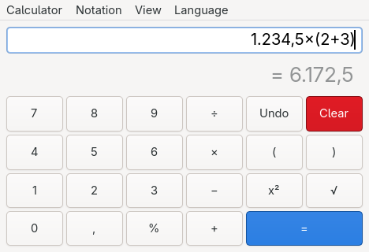
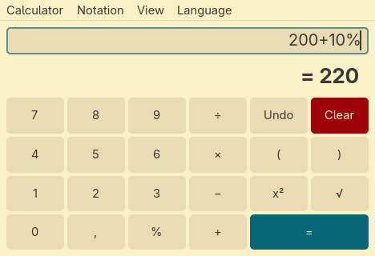
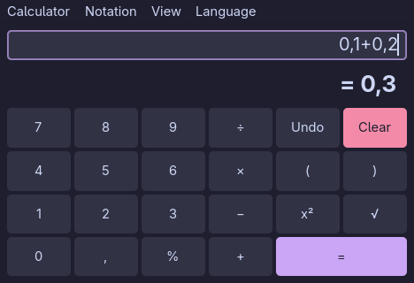
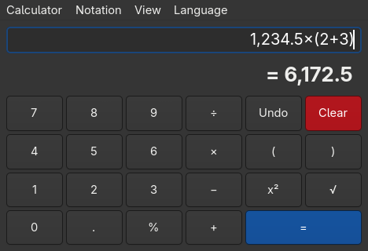
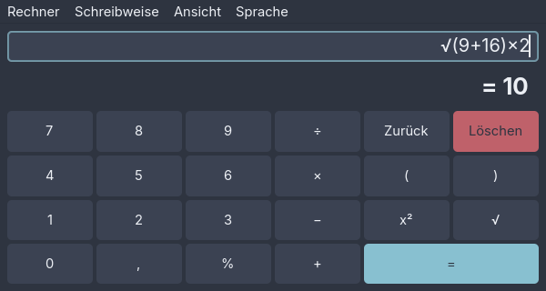

# Examples

Screenshots of rechner in a few of its themes.

## Light, with a live preview

`1.234,5×(2+3)` in decimal-comma notation. The result is still grey because
it is a preview; Enter or `=` confirms it.



## Gruvbox Light, percentages

`200+10%` adds ten percent of 200, so the result is `220`.



## Catppuccin Mocha, exact arithmetic

`0,1+0,2` is exactly `0,3`, because rechner calculates with decimals instead
of binary floating point.



## Dark, decimal-point notation

The same calculation as above, written as `1,234.5×(2+3)`. In this notation
`.` is the decimal separator and the numpad decimal key types `.`.



## Nord, German interface

Menus, keys and messages in German, computing `√(9+16)×2`.



## Regenerating

```sh
examples/screenshots.sh                  # all shots
examples/screenshots.sh german.png       # just the named ones
```

The script builds rechner, starts it once per shot with its own config and
D-Bus session, types the expression and captures the window. It needs sway,
`grim`, `jq` and `wtype`.

Don't touch the keyboard or mouse while it runs. If rechner loses focus, the
script stops instead of typing into another window.
